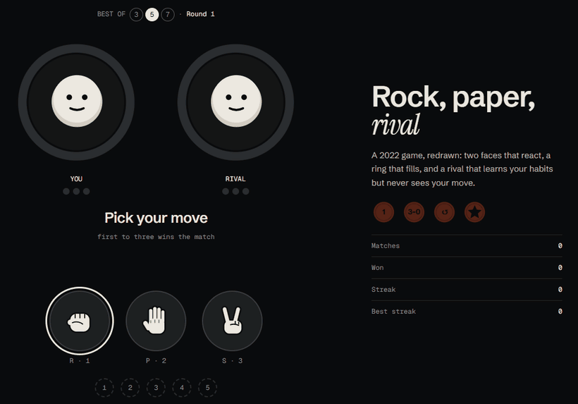

# Rock, paper, rival · rps-project002

Rock paper scissors, best of three, five or seven, against a rival that learns your habits but never sees your move. Two faces react to every round, a ring fills toward the win, and a coin lands when the match is yours.

**Live:** [yassinelakchouch.github.io/Rock_Peper_Scissors](https://yassinelakchouch.github.io/Rock_Peper_Scissors/) · **First version (2021):** [`/legacy/`](https://yassinelakchouch.github.io/Rock_Peper_Scissors/legacy/)



## Play

| Do | What happens |
| --- | --- |
| Open the page, then tap or press any key | The loading chant: the fists count "Rock… Paper… Scissors…" with rising ticks, then fly into the two rings on "shoot!"; any key during it skips to the arena. With reduced motion the same count runs calm: a fist lights up instead of rising, and nothing flies |
| First visit, after the chant | Four short scenes act a round out by themselves: a click, the wait, the rule, the stats. Then they leave. Any hand plays at once, Esc skips, and **How to play** in the footer brings them back |
| Pick the match length | Best of 3, 5 or 7 in the chips above the faces; first to 2, 3 or 4 wins |
| Tap a key, or press 1 2 3 / R P S | Your hand drops in; the rival's sealed pick shuffles for 0.6 s, then both flip |
| Win a round | Your ring fills by one win's share; best of five needs three |
| One win from the match | MATCH POINT, and the ring breathes |
| Win the match | The coin lands; your streak grows; Enter plays again |
| Play the same move a lot | The rival starts countering it, and says so after three reads |
| After the match | A read-out says how often the rival read you and which move you lean on |
| On a phone, with sound on | A short buzz when a round lands |

**The rival is fair:** it picks when a round opens, from your past moves only (60 % random, 40 % countering your most played move of the last five). It never sees the move you are about to make.

Badges: First match · Clean sweep (3–0) · Comeback (from 0–2) · Mind reader (5 rounds won against its read).

## Keyboard

Every key the game listens to. Keys held with Ctrl, Alt or Cmd are left to the browser, Tab moves focus everywhere, and while Stats is open the game ignores keys (Esc closes it).

| Key | When | What it does |
| --- | --- | --- |
| Any key | Loader | Starts the count |
| Any key again | Loader, during the count | Skips to the arena |
| Esc, or **Skip** | Opening scenes | Skips them |
| Space or → | Opening scenes | Steps on to the next scene |
| ← | Opening scenes | Steps back a scene |
| R P S, or 1 2 3 | Opening scenes | Ends them and plays that hand at once |
| R P S, or 1 2 3 | A round | Plays rock, paper or scissors |
| Enter | After a match | Plays again |
| **How to play** in the footer | Arena | Replays the opening scenes |

## How it was built

1. **Measured the 2021 version first**, then drew the new one on design boards: study, storyboard, screens, and later the loading chant and the opening scenes.
2. **Rules before pixels.** The first pull requests were the rules and a pure match reducer, then the rival, then stats, badges and storage, each with its tests. The faces, hands, rings and sounds came after, drawn and synthesized for this game.
3. **Shipped in the open.** 40 pull requests are merged, and each merge to `main` redeploys the site. Issues, labels and a wiki track the work.

## What I learned

- **Fairness has to be built in, not promised.** The rival seals its pick when the round opens, before you choose, so it cannot cheat even by accident; the tests check its 60 / 40 split over many rounds.
- **A pure reducer makes a game easy to test.** A match is `(state, move) → state`, so match point, comebacks and streaks are plain unit tests with no page involved.
- **Reduced motion is an operating-system setting, and "still" is not the only answer.** With Windows' animation effects off, Chrome reports `prefers-reduced-motion`. The loader first froze on one frame; it now runs a calm count, light instead of movement, so those visitors get the same beat.
- **Name classes with care.** In Tailwind, `ring` is already a utility (a 1 px box-shadow), so a class called `ring` drew a stray outline.

## What's next

Every issue on the last board (R-05: match length, the read-out, the buzz, the calm count) is shipped and closed. Ideas, not promises:

- A second rival with a different way of reading you.
- Two players on one keyboard.

## Run

```sh
npm ci
npm run dev        # http://localhost:5181
npm test           # 90 unit tests: rules, match, rival, stats, storage, sound, parts
npm run test:e2e   # 62 end-to-end tests on desktop and phone, in the installed Chrome
npm run build
```

## Stack

Vite 8 · TypeScript 7 (strict) · Tailwind CSS v4 (`@theme` tokens) · a pure match reducer · SVG faces, hands and rings drawn for this game · CSS keyframes for every moment · Web Audio for the sound effects · `localStorage` for stats, badges and sound · Vitest and Playwright.

## Layout

```
src/game    rules, the match reducer, the rival, stats and badges, storage
src/sound   the nine synthesized effects
src/ui      faces, hands, the ring and coins as SVG
src/app.ts  the page: rounds, motion, sound, keys and Stats
e2e/        Playwright flows
public/legacy/  the 2021 version, served at /legacy/
docs/       the plan, and the demo above
```
